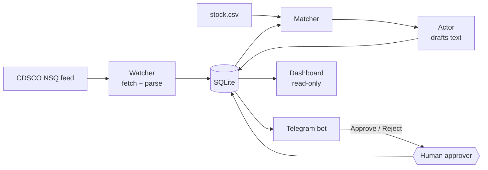

# BatchWatch

**Checks a pharmacy's stock against India's CDSCO "Not of Standard Quality" (NSQ) drug alerts, drafts the paperwork for every match, and lets a human approve each action in Telegram.**

Every month CDSCO publishes a list of drug batches that failed lab tests. A pharmacist has to compare that list against the shelves by hand, and a missed batch can reach a patient. BatchWatch does the comparison in seconds. It never acts on its own: nothing is sent until a named approver presses a button, and every step is written to a log that cannot be edited.

## How it works



1. **Watcher** fetches the month's alert table (one polite request, 2 retries, falls back to the last cached copy) and keeps only rows it has not seen.
2. **Matcher** compares every stock row with every stored alert row and returns `confirmed`, `uncertain` or `none`, each with a score and a plain-English reason.
3. **Actor** drafts an internal alert and a return request to the supplier from templates.
4. **Telegram bot** posts each match with the evidence and buttons. Approving "sends" the return request (a demo: nothing is emailed).
5. **Dashboard** shows counts, flagged stock and the audit log, read-only.

The pipeline is plain Python: one function per stage, one `state` dict passed along, stop rules in `orchestrator.py`. There are no agent frameworks.

## Safety design

- **A human approves every action.** Only Telegram user IDs in `APPROVER_IDS` can press buttons. Anyone else gets "view-only", and the attempt is logged with their ID.
- **The audit log is append-only.** SQL triggers abort any `UPDATE` or `DELETE` on it.
- **Decisions are atomic.** One SQL statement flips a match from `pending`, so two quick presses cannot both win.
- **The dashboard cannot write.** It opens SQLite with `mode=ro`, and a test checks the file is unchanged after it runs.
- **Missing a batch is worse than a false alarm,** so anything doubtful becomes `uncertain` for a person to check, never `none`.

## Matching rules

| Signal | Rule |
|---|---|
| Batch number | Normalised (uppercase, spaces, dashes and slashes removed) and compared. The **batch gate**: no batch match, no candidate. |
| **confirmed** | Batch identical, drug name >= 80% similar, manufacturer >= 60% similar (or absent) |
| **uncertain** | Batch identical but drug or manufacturer differs, **or** batch >= 90% similar (typo or misread) |
| Drug name | Best of the generic name and the brand name. Tab/Inj/Susp/HCl and similar abbreviations are expanded; IP/BP/USP tags are dropped. |
| Manufacturer | Pvt / Ltd / Private / Limited are ignored |

On the planted test set (200 stock rows, 9 planted batches, 3 near-miss batches): **9 of 9 found, 0 of 3 near-misses flagged, precision 1.00, recall 1.00.** Two planted rows with weak names (`Drotaverine Susp`, `Lofnec 2mg`) come out `uncertain`, as designed.

## Quick start

Needs Python 3.11 and a Telegram bot token from @BotFather.

```bash
pip install -r requirements.txt
```

Create a `.env` file (it is git-ignored; never commit it):

```
TELEGRAM_BOT_TOKEN=<token from @BotFather>
APPROVER_IDS=<comma-separated Telegram user IDs>
```

Send `/start` to the bot to see your own ID.

```bash
python -m batchwatch.bot                                              # the bot
streamlit run batchwatch/dashboard.py --server.address localhost      # the dashboard
python -m unittest discover -s tests -t .                             # 72 tests
```

Keep the dashboard on `localhost`: it has no login.

## 2-minute demo

1. Open the dashboard: 0 matches.
2. In Telegram, send `/run`. A summary appears, then one message per match with the stock location, quantity, reason and the CDSCO row as evidence.
3. Press **Approve** on a red (confirmed) match. The "SENT (demo)" return request appears.
4. Press **Confirm match** or **Not a match** on a yellow (uncertain) one.
5. Have a second account press a button: it is refused and logged.
6. Send `/log`, then refresh the dashboard. The counts and audit trail match.

## Project layout

```
batchwatch/
  agents/watcher.py    fetch + dedupe the NSQ feed      agents/parser.py   feed/PDF -> rows
  agents/matcher.py    fuzzy matching with reasons      agents/actor.py    draft texts
  orchestrator.py      watch -> match -> act            db.py              SQLite + audit log
  bot.py               Telegram approval flow           dashboard.py       read-only view
  data/                alerts cache, stock.csv, test truth
scripts/make_stock.py  regenerates the fake stock list  tests/            72 tests
```

## Honest limitations

- **The stock list is synthetic.** It is generated, with 9 real Sep 2026 NSQ batches planted in it. The accuracy numbers above measure that fixture, not a real pharmacy.
- **The main path uses no AI model.** Matching is deterministic fuzzy logic, which keeps it explainable. Gemini is used only as a fallback for old PDF alerts that fail table parsing, and that path has been tested with a mock but not against the live API.
- **44% of alert rows carry no brand name,** so a pharmacy that stocks by brand alone can only be matched through the generic name on those rows.
- **Short batch numbers** (under 10 characters) with a one-character typo score below the 90% fuzzy cutoff and are not flagged.
- **Telegram long polling:** the bot must be running on a machine that stays awake. Approvers are set in `.env` and need a restart to change.
- **Data source:** the CDSCO online NSQ table, fetched at most once per run. It is public data.
