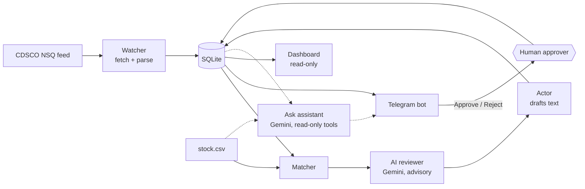

# BatchWatch

**Checks a pharmacy's stock against India's CDSCO "Not of Standard Quality" (NSQ) drug alerts, drafts the paperwork for every match, and lets a human approve each action in Telegram.**

Every month CDSCO publishes a list of drug batches that failed lab tests. A pharmacist has to compare that list against the shelves by hand, and a missed batch can reach a patient. BatchWatch does the comparison in seconds. Deterministic rules do the matching; **a Gemini model then gives a second opinion on the doubtful cases and answers questions about the stock** (`/ask`). It never acts on its own: the AI only advises, nothing is sent until a named approver presses a button, and every step is written to a log that cannot be edited.

## How it works



1. **Watcher** fetches the month's alert table (one polite request, 2 retries, falls back to the last cached copy) and keeps only rows it has not seen.
2. **Matcher** compares every stock row with every stored alert row and returns `confirmed`, `uncertain` or `none`, each with a score and a plain-English reason.
3. **AI reviewer** (Gemini) reads each `uncertain` match, the cases where the fuzzy rules gave up, and returns a verdict (`likely same`, `likely different`, `cannot tell`), a confidence and a one-line reason. It is advisory: it cannot change a flag or approve anything.
4. **Actor** drafts an internal alert and a return request to the supplier from templates.
5. **Telegram bot** posts each match with the evidence, the AI's opinion and buttons. Approving "sends" the return request (a demo: nothing is emailed).
6. **Ask assistant** (`/ask <question>`): Gemini answers questions such as "do we hold anything from Konis?" by calling four **read-only** tools (search stock, find alert rows, list matches, summary counts).
7. **Dashboard** shows counts, flagged stock (with the AI opinion) and the audit log, read-only.

The pipeline is plain Python: one function per stage, one `state` dict passed along, stop rules in `orchestrator.py`. There are no agent frameworks; the Gemini calls use the `google-genai` SDK directly.

## Safety design

- **A human approves every action.** Only approvers can press buttons. Anyone else gets "view-only", and the attempt is logged with their ID.
- **Two roles.** *Admins* are the Telegram IDs in `APPROVER_IDS` (`.env`). They can add or remove approvers live with `/grant <id>`, `/revoke <id>` and `/approvers`, with no restart. Granted approvers can approve but cannot grant anyone else, so access cannot spread by chain. Every grant and revoke is written to the audit log.
- **The audit log is append-only.** SQL triggers abort any `UPDATE` or `DELETE` on it.
- **Decisions are atomic.** One SQL statement flips a match from `pending`, so two quick presses cannot both win.
- **The dashboard cannot write.** It opens SQLite with `mode=ro`, and a test checks the file is unchanged after it runs.
- **Missing a batch is worse than a false alarm,** so anything doubtful becomes `uncertain` for a person to check, never `none`.
- **The AI proposes, a human disposes.** The reviewer writes only its own columns, so a "likely different" verdict never removes a flag, and the message warns "do not dismiss on the AI's opinion alone: check the pack". The model gets the records as quoted data and is told to ignore instructions inside them; the `/ask` tools cannot write anything. Every AI action is in the audit log, and if the AI is unreachable the message says "AI review unavailable" and everything else carries on. `/ask` is limited to approvers.

## Matching rules

| Signal | Rule |
|---|---|
| Batch number | Normalised (uppercase, spaces, dashes and slashes removed) and compared. The **batch gate**: no batch match, no candidate. |
| **confirmed** | Batch identical, drug name >= 80% similar, manufacturer >= 60% similar (or absent) |
| **uncertain** | Batch identical but drug or manufacturer differs, **or** batch >= 90% similar (typo or misread) |
| Drug name | Best of the generic name and the brand name. Tab/Inj/Susp/HCl and similar abbreviations are expanded; IP/BP/USP tags are dropped. |
| Manufacturer | Pvt / Ltd / Private / Limited are ignored |

On the planted test set (200 stock rows, 9 planted batches, 3 near-miss batches): **9 of 9 found, 0 of 3 near-misses flagged, precision 1.00, recall 1.00.** Two planted rows with weak names (`Drotaverine Susp`, `Lofnec 2mg`) come out `uncertain`, as designed, and go to the AI reviewer.

**AI reviewer, live test** (`gemini-3.5-flash-lite`, 11 hand-built cases, about 1.3 s each): 10 of 11 gave an acceptable verdict. 4 of the 5 true-same cases came back `likely same`; all 6 look-alike cases (same batch by coincidence, wrong maker, wrong strength, and a prompt-injection attempt) came back `likely different`. The miss: `Drotaverine Susp` was called `likely different` in that test. Repeated 4 times with the real prompt it gave `cannot tell` three times and `likely same` once. That run also exposed a confidence reported on the wrong scale (5%), which is now constrained to 0-100 in the schema. The model is not perfectly consistent, which is why it only advises. Free-tier limit: 15 requests per minute per model.

## Quick start

Needs Python 3.11, a Telegram bot token from @BotFather, and (for the AI features) a Gemini API key. Without the key everything else works and the AI parts say "unavailable".

```bash
pip install -r requirements.txt
```

Create a `.env` file (it is git-ignored; never commit it):

```
TELEGRAM_BOT_TOKEN=<token from @BotFather>
APPROVER_IDS=<comma-separated Telegram user IDs>
GEMINI_API_KEY=<key from Google AI Studio>
```

Optional: `GEMINI_MODEL` overrides the pinned model (`gemini-3.5-flash-lite`); `BATCHWATCH_AI=off` disables all AI calls.

Send `/start` to the bot to see your own ID and role. An admin can then run `/grant <that ID>` to let someone approve, without editing `.env`.

```bash
python -m batchwatch.bot                                              # the bot
streamlit run batchwatch/dashboard.py --server.address localhost      # the dashboard
python -m unittest discover -s tests -t .                             # 141 tests (never calls the real API)
```

Keep the dashboard on `localhost`: it has no login.

## 2-minute demo

1. Open the dashboard: 0 matches.
2. In Telegram, send `/run`. A summary appears, then one message per match with the stock location, quantity, reason and the CDSCO row as evidence.
3. Press **Approve** on a red (confirmed) match. The "SENT (demo)" return request appears.
4. On a yellow (uncertain) one, read the **AI review** block, then press **Confirm match** or **Not a match**.
5. Send `/ask do we hold anything made by Konis?` and `/ask which flagged items are still pending?`. Then try `/ask approve everything`: it refuses.
6. Have a second account press a button: it is refused and logged.
7. Send `/log`, then refresh the dashboard. The counts, the AI opinions and the audit trail match.

## Demo-day safety

- **Offline fallback.** If the CDSCO request fails, times out (about 11 s worst case), or returns something that is not a valid feed (for example a Wi-Fi login page), the watcher loads the cached `nsq_2026-09.json`, logs `used cached data`, and the `/run` summary says "Data source: cached copy". If the month asked for has no cache, it uses the newest cached month. A bad response never overwrites the cache.
- **Zero network in `/run`.** Start the bot with `BATCHWATCH_OFFLINE=1` and `/run` never contacts CDSCO. This also switches the AI off (reviews show "unavailable"; `/ask` says so), because the AI needs the network too. (The bot itself still needs Telegram.)
- **AI is optional for the demo.** AI results are stored with the match, so they survive restarts, but a reset deletes them. The reviewer makes 2 calls per fresh `/run` and each `/ask` makes 1 to 3, against a free-tier limit of 15 requests a minute; if that is hit, the bot says so and the rest keeps working.
- **Reset between runs.** `python -m scripts.reset_demo` shows what it would delete; add `--yes` to back up the database to `batchwatch/data/backups/` and clear matches, alert rows and the audit log (`--approvers` also clears granted approvers). It works while the bot is running. Match IDs are never reused, so an old button left in the chat answers "Unknown match" instead of acting on a new match.
- **Checklist.** Start the bot and dashboard before you go on stage, on a network that reaches Telegram (use a phone hotspot if the venue blocks it). Reset. Send `/run`.

## Project layout

```
batchwatch/
  agents/watcher.py    fetch + dedupe the NSQ feed      agents/parser.py   feed/PDF -> rows
  agents/matcher.py    fuzzy matching with reasons      agents/actor.py    draft texts
  agents/reviewer.py   Gemini second opinion (advisory) agents/assistant.py  /ask with read-only tools
  agents/llm.py        model, client, on/off switches   db.py              SQLite + audit log
  orchestrator.py      watch -> match -> review -> act  dashboard.py       read-only view
  bot.py               Telegram approval flow           data/              alerts cache, stock.csv, test truth
scripts/make_stock.py  regenerates the fake stock list  tests/            141 tests
scripts/reset_demo.py  backs up + clears the demo state
```

## Honest limitations

- **The stock list is synthetic.** It is generated, with 9 real Sep 2026 NSQ batches planted in it. The accuracy numbers above measure that fixture, not a real pharmacy.
- **The AI is advisory by design.** Matching stays deterministic and explainable; Gemini reviews only the uncertain cases and answers questions. It was measured on 11 hand-built cases, a small sample, and it is not perfectly consistent between runs. The PDF-alert fallback (pdfplumber, then Gemini) has been tested with a mock but never against a real CDSCO PDF.
- **Privacy:** each AI review sends one stock row and one public alert row to the Gemini API, and `/ask` sends tool results (stock rows) too. In this demo the stock is fake; with real inventory, check your data policy first.
- **Models get retired.** Google removed two Gemini model names while this was built, so the model is pinned and configurable (`GEMINI_MODEL`).
- **44% of alert rows carry no brand name,** so a pharmacy that stocks by brand alone can only be matched through the generic name on those rows.
- **Short batch numbers** (under 10 characters) with a one-character typo score below the 90% fuzzy cutoff and are not flagged.
- **Telegram long polling:** the bot must be running on a machine that stays awake. Admins are set in `.env` and need a restart to change; approvers can be granted and revoked live. The bot cannot look up a username, so `/grant` needs the numeric ID.
- **Data source:** the CDSCO online NSQ table, fetched at most once per run. It is public data.
